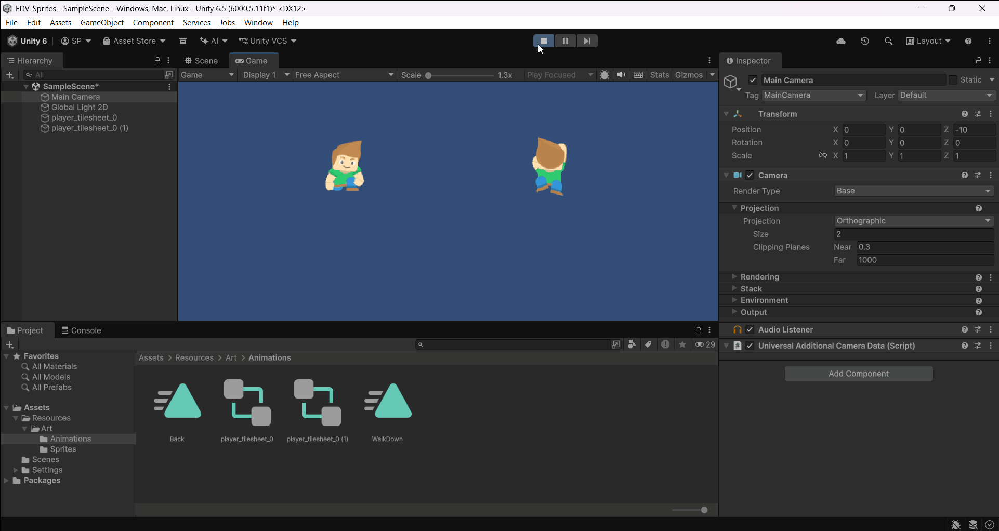
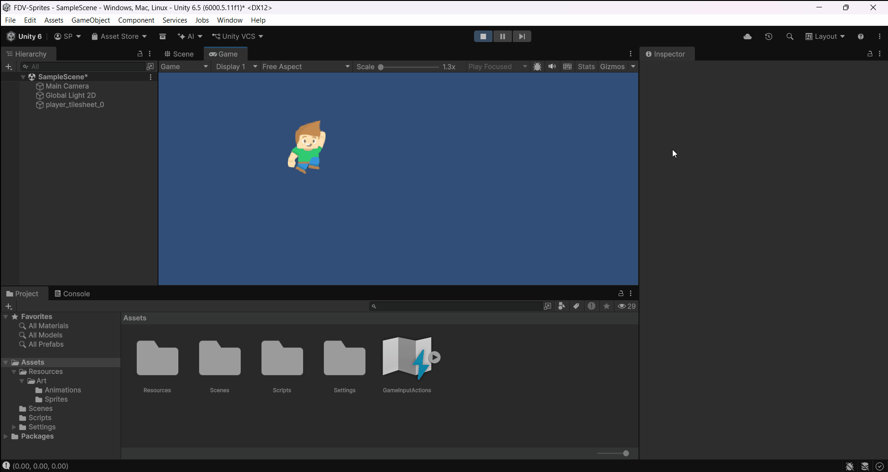
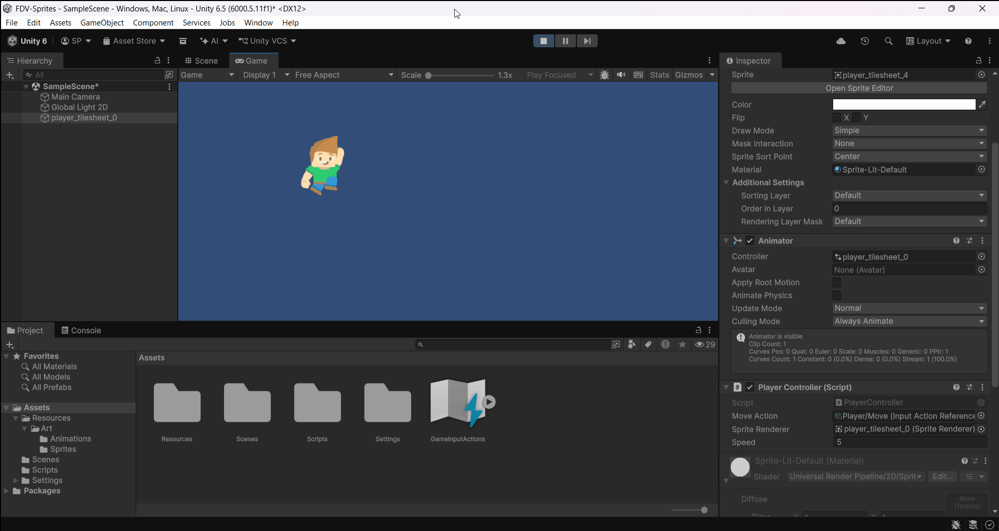
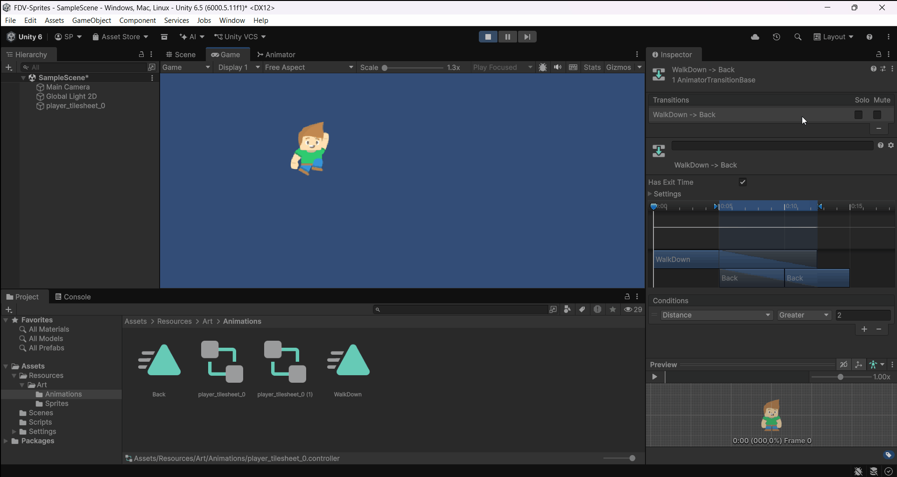

# FDV-Sprites
## Ejercicios
> Agregar el atlas de sprites del personaje a la escena. Configurar el sprite como múltiple y subdividirlo para tener acceso a los sprites para generar las animaciones. Agregar una de las imágenes a la escena.


Al importarlo, automáticamente se ha detectado que es una hoja de múltiples sprites y los ha subdividido correctamente. Colocando un sprite en escena se ve de la siguiente manera:


> Creamos un objeto 2D, arrastrando un conjunto de imágenes que selecciones al objeto añadiremos una animación. Agregar al personaje la animación “Walk Down” . Añadir otra imagen y generarle otra animación.  De esa forma Unity crea un objeto Animation, la primera vez que se crea, también añade un objeto Animator Controller.

Se ha creado la animación Walk Down y asignado al personaje de la izquierda. Después, se ha creado otra animación Back y se ha asignado al personaje de la derecha. Cada uno tiene un controller diferente porque se han creado las animaciones en objetos diferentes.


> Creamos los scripts para controlar el movimiento para el personaje. Inicialmente vamos a hacer una versión sin salto. Añadir los scripts necesarios para moverlo por la pantalla. En este caso sólo tendremos que mover las coordenadas (X, Y).  El movimiento de derecha a izquierda lo logramos modificando transform.position(x, y), para ello podemos usar transform.Translate(avance, 0).

> Controlar el movimiento por teclado: el avance se produce si el jugador ha pulsado las teclas flecha izquierda o flecha derecha.

> Necesitarás las instrucciones:
float horizontalInput = Input.GetAxis("Horizontal");
Vector2 movement = new Vector2(horizontalInput, 0f); 
transform.Translate(movement * speed * Time.deltaTime);

En este caso, combino los apartados 3, 4 y 5 porque de costumbre suelo configurar el input system nuevo al realizar desplazamientos para que sea más cómodo y sencillo.


Tras configurar las acciones, utilizando el siguiente script desplazo al personaje:
```cs
void Update()
{
    movement = new Vector2(moveAction.action.ReadValue<float>(), 0f); 
    transform.Translate(movement * Time.deltaTime * speed);
}
```


> Además necesitamos que el sprite se oriente hacia donde camina, podemos hacerlo usando la propiedad Flip en el eje X en función de si se está moviendo hacia la izquierda (movimiento negativo) o hacia la derecha (movimiento positivo):
Obtener el componente SpriteRenderer para poder modificar el sprite. Deberías hacerlo sólo una vez.
Comprobar la dirección del movimiento usando el valor de horizontalInput. 
Usar una condición if para saber si el personaje se mueve a la derecha.
Usar una condición else if para saber si se mueve a la izquierda.
SpriteRenderer spriteRenderer;
spriteRenderer.flipX

Para esto, añado esta condición:
```cs
if (moveX > 0)
{
    spriteRenderer.flipX = false;
} else if (moveX < 0)
{
    spriteRenderer.flipX = true;
}
```
En caso de no moverse, se mantiene el último lado hacia al que miraba el personaje.



> Crear las animaciones del personaje: Para cada animación que queramos agregar a un objeto seleccionamos la colección de sprites que forman la animación y la arrastramos hasta él. Agregaremos todas las animaciones al personaje. El objeto Animator Controller las gestiona en la ejecución.
Con la animación seleccionada podemos arrastrar el objeto jugador e ir visualizando las animaciones.
En la pestaña Animator disponemos de una interfaz gráfica que nos permite definir de forma visual la máquina de estados que controla la animación. Por defecto, del estado inicial (Entry) se pasa a la animación Idle. Las transiciones pueden estar controladas por parámetros que nos permitirán definir scripts asociados controlados por valores que tome el parámetro.
private Animator animator;
animator = GetComponent<Animator>();
animator.SetBool("isWalking", true);
Crear un script, en el que el personaje, después de caminar una distancia determinada cambie la animación. Para ello, debes:
Declarar una variable para ir actualizando en cada frame la distancia recorrida. 
Una variable que le puedas dar el valor que quieras que active el cambio, si la variable distancia supera el valor, se tiene que pasar a otra animación
Obtener una referencia al Animator: Tienes que acceder al componente Animator sólo una vez para utilizarlo en el código. Debes obtener una referencia a él en tu script para poder controlar el cambio de una animación a otra.
En cada frame debes calcular cuánto se ha movido el personaje desde la posición inicial.
Si la distancia total recorrida supere la distancia de activación, tu script debe indicarle al Animator que reproduzca la nueva animación.
Calcular la distancia que hay entre la posición actual y la que anterior 
distanceThisFrame =
Vector3.Distance(firstPosition, transform.position);

Para hacer esto, se ha creado una variable Distance dentro del animator. Además, se ha incluido la animación Back aparte de la WalkDown. La transición se ha configurado de manera que la condición de transición es que la distancia sea mayor que 2.


Después, en el código, se han añadido las siguientes líneas en el `Update` para actualizar la distancia y enlazarla a la variable del animator.
```cs 
distanceThisFrame = Vector3.Distance(firstPosition, transform.position);
animator.SetFloat("Distance", distanceThisFrame);
```
Como resultado, la animación cambia con la distancia elegida:


> Experimenta con el concepto de PPU: Abre el Sprite Editor y anota el tamaño en píxeles de uno de los sprites del personaje (ancho × alto).  En el Inspector del atlas, busca el valor de Pixels Per Unit. ¿Cuál tiene por defecto? Calcula cuántas unidades medirá el personaje en la escena. Comprueba tu cálculo: añade al personaje un BoxCollider2D y mira su propiedad Size, o compáralo con la cuadrícula de la vista Scene (cada celda es 1 unidad). Cambia el PPU a 16, 32 y 100, pulsando Apply cada vez. Anota cuánto mide el personaje en cada caso. Al cambiar el PPU, ¿ha cambiado la imagen? ¿Qué ha cambiado entonces?. Elige un PPU para que el personaje mida entre 1 y 2 unidades de alto. ¿Qué valor has elegido y por qué?

El primer sprite es 65x98. Por defecto, está marcado como 100 píxeles por unidad.
Haciendo la división tamaño de imagen / ppu, obtenemos que el tamaño del personaje en pantalla es de 0.65x0.98 U. 
Comprobamos que esto es correcto poniéndole un Box Collider 2D:


Probando con los diferentes PPUs, tenemos los siguientes tamaños:
- 16 PPU: 4.0625x6.125 U
- 32 PPU: 2.03125x3.0625 U
- 100 PPU: 0.65x0.98 U

La imagen como tal no cambia. El sprite sigue siendo el mismo. Lo que cambia es su representación en el mundo. Cuanto más pequeño sea el PPU, más grande se vuelve el personaje.
Si queremos que el personaje esté entre 1 y 2 unidades de alto, por ejemplo 1,5, el resultado de dividir tamaño de imagen / PPU deberá ser 1,5. Despejando, obtenemos que tamaño de imagen / 1.5 = PPU. Por tanto, para un alto de 98 píxeles, el PPU debe ser 65,33. 
Esto se verifica aplicando el PPU y comprobando el tamaño en el Box Collider 2D:

